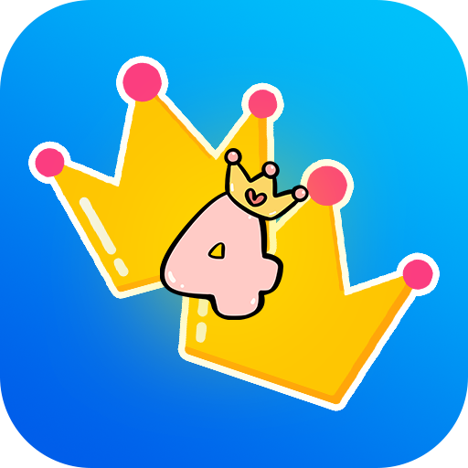
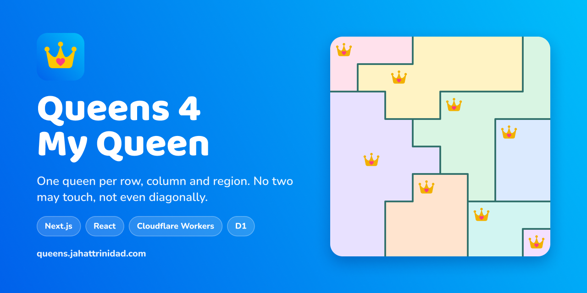
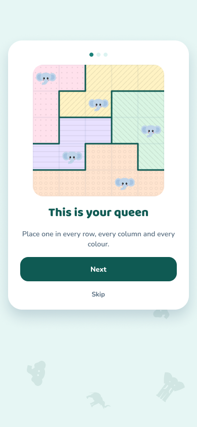
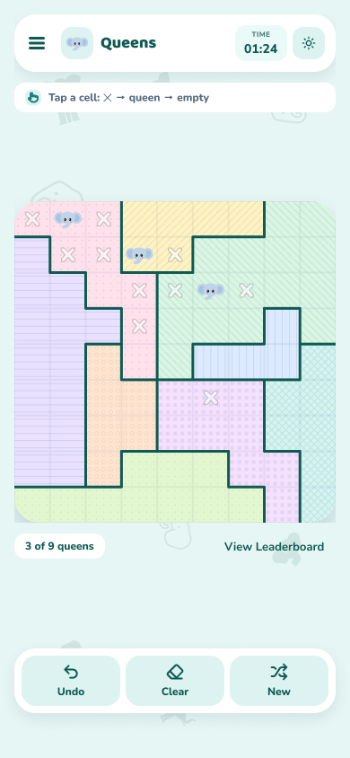
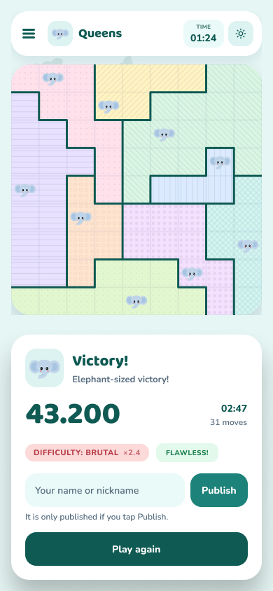
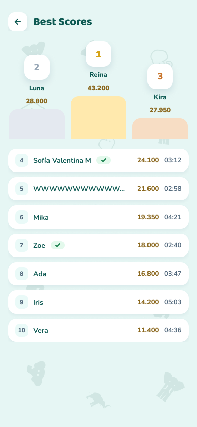
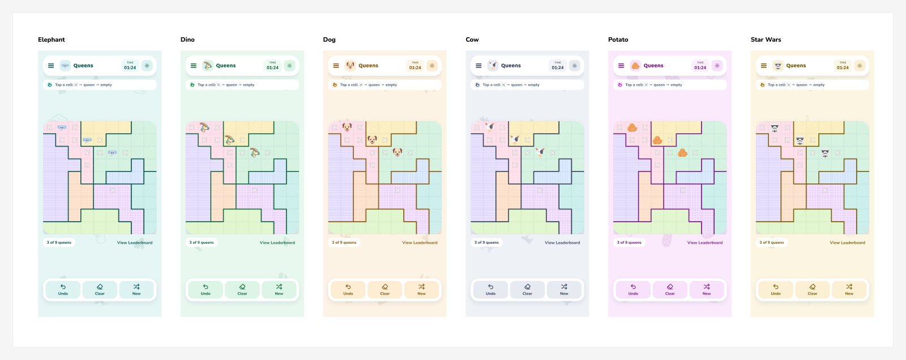
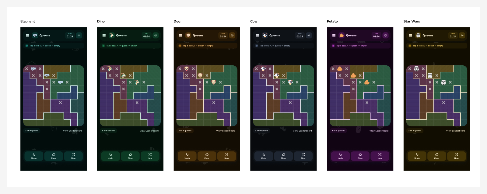

<p align="center">
  
</p>

<h1 align="center">Queens 4 My Queen</h1>

<p align="center">
  A Queens logic puzzle that runs entirely in the browser.<br>
  <a href="https://queens.jahattrinidad.com"><strong>Play it at queens.jahattrinidad.com</strong></a>
</p>

<p align="center">
  <a href="https://github.com/trinity-bytes/queens-game/actions/workflows/deploy.yml"></a>
  
  
  
  
  
  
</p>



## How to play

Place one queen in every **row**, every **column** and every **coloured region**. Queens can never touch, not even diagonally.

- **Tap** a cell to cycle it: empty → ✕ → queen → empty.
- **Drag** across the board to mark several cells with ✕ at once. Marks are free.
- **Harder boards pay more.** Each board is graded Gentle (×1.0), Tricky (×1.6) or Brutal (×2.4). Every misplaced queen costs 8 % and time costs nothing.

<p align="center">
  
  
  
  
</p>

## Features

| | |
| --- | --- |
| **First run** | A three-step lesson on a 5×5 board before the clock starts |
| **Clear feedback** | Clashing queens are ringed and the strip names the broken rule |
| **Thumb dock** | Undo, Clear and New within reach, with a confirm before losing a board |
| **Saved games** | A game in progress survives a reload |
| **Leaderboard** | A score is published only when the player taps Publish |
| **Themes** | Six themes (elephant, dino, dog, cow, potato, Star Wars), each in light and dark |
| **Installable** | A PWA that works offline, with system bars matching the page |
| **Accessible** | Playable from the keyboard, with screen reader announcements |
| **Languages** | English and Spanish |




## Architecture

| Path | Role |
| --- | --- |
| `src/` | Next.js app, built as a static export into `out/` |
| `src/domain/scoring.ts` | Score formula, shared by the game and the API |
| `api/` | Cloudflare Worker serving `/api/leaderboard` |
| `migrations/` | D1 schema |

The Worker is the anti-cheat boundary: `api/leaderboard/submission.ts` validates every field and recomputes the score. Only `/api/*` reaches it; pages come straight from the asset store. The board refreshes by polling every 30 seconds while the tab is visible.

## Development

```bash
npm install
npm run dev:api   # Worker and local D1 on :8787
npm run dev       # Next.js on :3000, proxies /api to the Worker
```

`npm run preview` builds and serves the production output from a local Worker, service worker included.

```bash
npm test            # runs in workerd against a real local D1
npm run typecheck
npm run lint
```

## Deployment

Every push to `main` runs lint, typecheck and tests, then deploys to [queens.jahattrinidad.com](https://queens.jahattrinidad.com) (see `.github/workflows/deploy.yml`). Releases follow git flow: `release/x.y.z` merges into `main` and `develop`, and the merge to `main` is what ships.

The workflow needs a `CLOUDFLARE_API_TOKEN` repository secret: a token from the "Edit Cloudflare Workers" template, with Account > D1 > Edit added.

To deploy by hand, after `npx wrangler login`:

```bash
npm run deploy    # build, apply D1 migrations, deploy the Worker
```

## Design

The full UI, every theme and the share assets live in the [Figma UI map](https://www.figma.com/design/UfBsK7B2ukIMqhntnysEDE). The screenshots in this README are exported from it.

## Credits

Designed and developed by [trinity-bytes](https://github.com/trinity-bytes). Theme and queen icons by Freepik on [Flaticon](https://www.flaticon.com).
